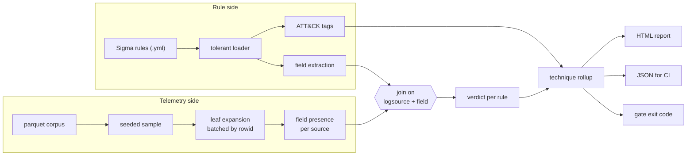
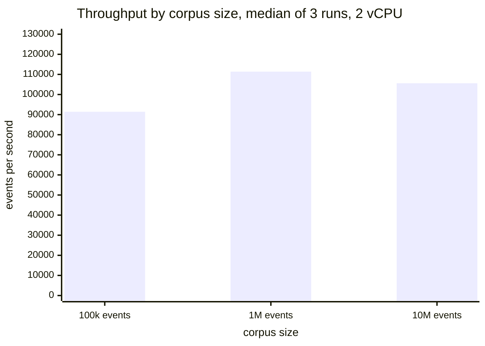

# detection-coverage-audit

**Finds the ATT&CK techniques your rules claim to cover and your telemetry cannot see. On the bundled example, <!--number:audit.blind_technique_pct-->66.7<!--/number--> percent of mapped techniques have no rule that could fire.**

[](https://github.com/__GITHUB_USERNAME__/detection-coverage-audit/actions/workflows/ci.yml)
[](https://github.com/__GITHUB_USERNAME__/detection-coverage-audit/actions/workflows/coverage-badge.yml)
[](docs/metrics.json)
[](https://__GITHUB_USERNAME__.github.io/detection-coverage-audit/)
[](LICENSE)

## What this solves

- **A coverage heatmap counts rules, not capability.** This joins each rule to the fields actually present in sampled telemetry, and reports the techniques where nothing could fire. On the bundled rule pack that is <!--number:audit.techniques_blind-->18<!--/number--> of <!--number:audit.techniques_mapped-->27<!--/number--> mapped techniques.
- **Sysmon content on a 4688 estate is the usual culprit.** Rules keyed on `Image` and `ParentImage` cannot match Windows Security EventID 4688, which populates `NewProcessName` and `ParentProcessName`. That single mismatch produces <!--number:audit.verdict_counts.missing_field-->8<!--/number--> of the <!--number:audit.rules_audited-->18<!--/number--> findings here.
- **It runs as a CI gate, not a report nobody opens.** `dca gate` exits non zero above a blind percentage you set, so coverage regressions fail a pull request on the detection content repo.

## The problem

Detection coverage is usually reported as a heatmap: a technique is green when a
rule is mapped to it. That measures intent. It does not check whether the field
the rule keys on exists in the telemetry that was actually onboarded, and it
cannot, because the rule repository and the log pipeline are different systems
owned by different people.

The gap is not theoretical. The large public Sigma rule sets are written against
Sysmon field names. A great many estates audit process creation through Windows
Security EventID 4688 instead, which carries different field names for the same
data. Every one of those rules parses, deploys, maps to a technique, turns the
heatmap green, and can never fire. Nobody finds out until an incident review
asks why nothing alerted.

This tool measures the difference. It reads a directory of Sigma rules, profiles
which fields each log source actually populates in a telemetry export, joins the
two, and reports per rule whether the rule could fire at all. Then it rolls that
up to technique level, applying the same standard a heatmap applies: a technique
is covered when at least one rule mapped to it can fire.

On the bundled rule pack of <!--number:audit.rules_audited-->18<!--/number--> rules against a <!--number:audit.corpus_events-->1,000,000<!--/number--> event synthetic corpus spanning <!--number:audit.log_sources_observed-->6<!--/number--> log sources and <!--number:audit.distinct_fields_observed-->38<!--/number--> distinct fields, <!--number:audit.blind_technique_pct-->66.7<!--/number--> percent of mapped techniques are blind. That corpus is generated, so that figure is a simulation, and it is a simulation calibrated to a real failure mode rather than an invented one: the rules are ordinary public style Sigma content and the Windows schema is EventID 4688 as Microsoft documents it.

## Architecture



Failures are handled at three boundaries. A rule file that will not parse
becomes a finding rather than an exception, so one broken file in a shared
repository cannot stop the audit. A log source absent from the corpus short
circuits to `no_source` before field resolution, so a missing pipeline is never
reported as eighteen missing fields. The profiler batches by `rowid` range so a
corpus larger than memory does not abort the run.

## Tech stack

| Technology | Role in this project | Why chosen here |
| --- | --- | --- |
| Python 3.11+ | Core, CLI, tooling | The automation language this problem is already solved in badly, by hand, in most SOCs |
| DuckDB | Field presence scan over parquet | `json_tree` gives recursive field extraction in SQL, and a library means no cluster to operate. See ADR-002 |
| PyYAML | Sigma rule parsing | pySigma was measured and rejected: it aborts a whole collection when one rule is malformed, and an unparseable rule is a finding this tool must report. See ADR-005 |
| Typer | CLI with three verbs | Typed arguments and subcommands with a small dependency surface |
| Jinja2 | HTML report | The report is an artifact a lead reads in a review, not terminal output |
| pandas | Chunked corpus generation | Chunked DataFrame insert measured 22 times faster end to end than `executemany`. See ADR-003 |
| pytest, pytest-cov | <!--number:quality.test_count-->99<!--/number--> tests, <!--number:quality.test_coverage_pct-->99.2<!--/number--> percent branch coverage | Runs with no network, no API keys and no containers |

## Quickstart

Prerequisites: Python 3.11 or newer, and git. No containers, no cloud account,
no SIEM credentials.

```bash
git clone https://github.com/__GITHUB_USERNAME__/detection-coverage-audit.git
cd detection-coverage-audit
python -m venv .venv && source .venv/bin/activate
make install
make verify
```

`make verify` runs ruff and the full test suite with coverage. Then run an audit
against a generated corpus:

```bash
dca generate-telemetry --events 200000 --out data/generated/corpus.parquet --seed 7
dca audit --rules rules/ --telemetry data/generated/corpus.parquet \
  --out docs/report.html --json docs/audit.json
```

Open `docs/report.html`. To use your own telemetry, export it to parquet with
two columns, `logsource_key` and `event`, where `event` is the raw JSON record,
and point `--telemetry` at that instead. At that point the numbers stop being a
simulation.

To gate a detection content repository in CI:

```bash
dca gate --rules rules/ --telemetry corpus.parquet --max-blind-pct 40 --max-unparseable 0
```

Exit code 2 means a threshold was breached. Pick the starting threshold from
what the audit reports today and ratchet it down; a gate set to a number the
repository cannot currently meet gets disabled within a week.

## Performance under load

Profiling is the dominant cost and the audit itself is effectively free, which
is the expected shape: leaf expansion touches every event, while the join
touches each rule once. Measured with `benchmark/run_benchmark.py`, median of 3
runs per scenario, on 2 vCPU with 8GB RAM, Python 3.13 on Linux. Raw output is
in `benchmark/results/benchmark.json`.

Runtime scales linearly, which is the uninteresting half. The claim worth
checking is that throughput does not degrade as the corpus grows, because that
is what the batched profiler is for:



A flat bar chart is the point: a profiler whose memory scaled with corpus size
would show the third bar collapse, or produce no third bar at all, which is
exactly what happened before ADR-004.

| Events | Corpus size | Profile (median) | Audit (median) | End to end | Throughput |
| --- | --- | --- | --- | --- | --- |
| <!--number:performance.scenarios[0].events-->100,000<!--/number--> | <!--number:performance.scenarios[0].corpus_mb-->3.0<!--/number--> MB | <!--number:performance.scenarios[0].profile_median_s-->1.08<!--/number--> s | <!--number:performance.scenarios[0].audit_median_s-->0.014<!--/number--> s | <!--number:performance.scenarios[0].end_to_end_median_s-->1.094<!--/number--> s | <!--number:performance.scenarios[0].events_per_second-->91,433<!--/number--> events/s |
| <!--number:performance.scenarios[1].events-->1,000,000<!--/number--> | <!--number:performance.scenarios[1].corpus_mb-->29.7<!--/number--> MB | <!--number:performance.scenarios[1].profile_median_s-->8.962<!--/number--> s | <!--number:performance.scenarios[1].audit_median_s-->0.017<!--/number--> s | <!--number:performance.scenarios[1].end_to_end_median_s-->8.978<!--/number--> s | <!--number:performance.scenarios[1].events_per_second-->111,378<!--/number--> events/s |
| <!--number:performance.scenarios[2].events-->10,000,000<!--/number--> | <!--number:performance.scenarios[2].corpus_mb-->296.6<!--/number--> MB | <!--number:performance.scenarios[2].profile_median_s-->94.681<!--/number--> s | <!--number:performance.scenarios[2].audit_median_s-->0.019<!--/number--> s | <!--number:performance.scenarios[2].end_to_end_median_s-->94.7<!--/number--> s | <!--number:performance.scenarios[2].events_per_second-->105,597<!--/number--> events/s |

Throughput is flat at roughly 105,000 events per second across two orders of
magnitude, which is the point of the batched profiler: runtime is linear and
memory is constant.

Where it degrades: a 90 day window at 2,000 events per second is 15.5 billion
events, which at this throughput is roughly 41 hours. Full replay is the wrong
tool at that size and `--sample` is the answer, with the accuracy trade stated
in ADR-001. The honest ceiling for a full replay on one machine is around a day
of telemetry per hour of audit.

## Architecture decision records

Four decisions in [`docs/adr/`](docs/adr/), each with the options rejected and why:

- [ADR-001](docs/adr/adr-001-sampled-field-presence.md): sampled field presence over full replay, and why the RARE_FIELD verdict exists because of it.
- [ADR-002](docs/adr/adr-002-duckdb-over-elasticsearch.md): the boring choice. DuckDB over Elasticsearch, a library over a cluster, and what that buys in testability.
- [ADR-003](docs/adr/adr-003-chunked-dataframe-insert.md): chunked DataFrame insert over `executemany`, with the 2,403 against 53,938 events per second that forced it.
- [ADR-004](docs/adr/adr-004-bounded-batch-profiling.md): bounded batch profiling, and the out of memory error at 10M events that caused it.
- [ADR-005](docs/adr/adr-005-tolerant-yaml-over-pysigma.md): why the loader parses YAML itself instead of using pySigma, with the error pySigma raises on a pack containing one broken rule.

## Intentionally out of scope

**Live SIEM connectors.** The tool reads a parquet export rather than querying
Splunk or Sentinel. That keeps the test suite free of credentials and keeps a
weekly audit off the platform the SOC depends on. Trigger to add a Splunk REST
ingestion path: when the rule set passes 500 rules, or when the audit needs to
answer "will this new rule fire" interactively rather than on a schedule.

**Rule logic evaluation.** The audit resolves field presence, not whether a
rule's conditions would match any real event. A rule keyed on
`EventID: 4688` and `CommandLine|contains: 'this string never occurs'` is
reported as resolved, because every field it needs is there. Measuring match
rates needs value level analysis, which means reading field values, which this
tool deliberately never does. Trigger: a separate tool, with a separate threat
model, if a team wants it.

**Condition modifier semantics.** Sigma modifiers are stripped to get at field
names and are not otherwise interpreted. `|base64offset|contains` and `|re`
affect whether a rule matches, not which field it reads, so they are out of
scope for a coverage question.

**Non Sigma rule formats.** Splunk SPL and KQL rule sets are not parsed. The
field extraction interface is one function, so adding a parser is small work,
and it is deferred until someone has a corpus to test it against.

**Full Sigma semantics.** The loader reads the detection block as YAML and takes
field names from it. It does not build a Sigma abstract syntax tree, resolve
field mapping pipelines, or evaluate backend conversion. pySigma does all three
and was measured and rejected for this tool's purpose; ADR-005 has the reason
and the error. If the audit ever needs to answer a question about rule semantics
rather than field references, pySigma is the right dependency to add back, for
the valid subset of a rule pack only.

## Security and compliance

The telemetry corpus is the sensitive asset: it contains usernames, hostnames,
internal addresses and command lines. **The audit reads field names and counts,
and never reads or emits field values.** That constraint is why the reports,
the JSON and the structured log are all safe to attach to a ticket, and it is
enforced by the design rather than by care.

The tool makes no network calls in the audit path, needs no credentials, and
never writes to the SIEM or the rule repository. The report template escapes all
rule derived text, because rule files come from repositories a team may not own.
Dependabot covers pip and Actions, and CI runs on every pull request. Full threat
model in [SECURITY.md](SECURITY.md).

## Failure modes

| Failure | Detection | Behaviour | Recovery |
| --- | --- | --- | --- |
| Rule file will not parse | Loader catches the YAML error | Reported as an `unparseable` finding, audit continues | Fix the file; `--max-unparseable 0` fails CI until then |
| Rule has no `detection` block | Loader checks for the key | `unparseable` finding, audit continues | Same |
| Log source absent from the corpus | Source key missing from the profile | `no_source` verdict, field resolution skipped | Onboard the source or retire the rule |
| Telemetry corpus missing | `FileNotFoundError` naming the path | Exits non zero before any work | Fix the path |
| Telemetry corpus empty | Row count checked before profiling | `ValueError`, exits non zero | An empty export is a pipeline failure, not a coverage finding |
| Corpus larger than memory | Batched by `rowid` range | Memory stays flat, runtime stays linear | None needed; this was ADR-004's bug |
| Malformed schema spec | Validated on load, shares must sum to 1.0 | `SchemaError` naming the source and field | Fix `schemas.yml` |
| Field rarer than the sample rate | Reported as `missing_field` when sampling | Over reports blindness, never under reports | Re-run without `--sample` to confirm |
| Published number drifts from measured | `tools/check_numbers.py` in CI | Build fails | `make report`, update the README |

## Hardest problem solved

The profiler reported Zeek's `id.orig_h` and CloudTrail's nested
`userIdentity.type` as the same kind of thing, and that turned out to be hiding a
worse bug underneath it.

The symptom was mild. Field presence numbers looked right, every test passed, and
the audit resolved Zeek rules correctly. What caught my attention was that
DuckDB's `json_tree` returns `fullkey` of `$.id.orig_h` for two structurally
different events: `{"id.orig_h": "10.0.0.1"}`, which is one key that happens to
contain a dot and is exactly how Zeek writes connection tuples, and
`{"id": {"orig_h": "10.0.0.1"}}`, which is a nested object. I was building the
dotted path by stripping the `$.` prefix off `fullkey`, so both collapsed to the
same string and the tool could not tell an operator which of the two shapes
their telemetry held. Those need different field extractions in the SIEM, so the
report was giving confident advice it had no basis for.

The fix was to stop reading the path off `fullkey` and reconstruct it from
`json_tree`'s parent `path` plus the leaf's own `key`, then record whether that
leaf key contained a dot. Fifteen minutes of work. The interesting part came
next: with the shapes now distinguishable, the Zeek sources in my own generated
corpus reported as nested objects, which Zeek never produces. The generator was
the problem. Its `_assign` helper split every field name on dots and nested the
value, so the quoted schema key `"id.orig_h"` became `{"id": {"orig_h": ...}}`.
The schema specification had no way to express the difference, so the generator
could not have known. Every Zeek field in every corpus had been the wrong shape
from the first commit, and the only reason nothing failed is that the old
profiler flattened both shapes identically, so two bugs had been cancelling each
other out.

That is the part worth keeping. A test would not have found it, because the test
would have been written against the same flawed assumption as the code. What
found it was making an invisible distinction visible and then looking at what the
tool said about data I already knew the shape of. The schema now carries an
explicit `literal_key` flag, the generator respects it, and a test asserts that
Zeek's tuple fields are literal keys while CloudTrail's identity fields are
nested, so neither bug can come back alone or in a pair.

Fixes: [`38f51ca`](../../commit/38f51ca) reconstructs the path and records the shape, [`b3eef45`](../../commit/b3eef45) stops the generator nesting literal keys.

## Future work

- **Splunk REST ingestion** so the audit can run against live telemetry on a schedule instead of an export. The field presence interface is already the seam.
- **Field drift detection.** Field presence per source is already computed; storing it per run would show a log source silently dropping a field that live detections depend on, which is the same failure as this tool's findings but arriving over time.
- **Splunk SPL and KQL parsers** behind the existing field extraction interface, so estates that are not Sigma first can use it.
- **Before production use:** confirm the parquet export path does not duplicate events across windows, and decide where the audit output is stored, because a history of blind technique percentages is more useful than any single run.
- **First metric to watch after deploying:** blind technique percentage per log source, not in aggregate. Aggregate movement hides a single newly onboarded source carrying the whole improvement while another quietly regresses.

## License

MIT. See [LICENSE](LICENSE).
