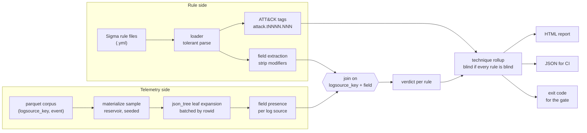

# How the audit works

The audit joins two things that are normally never compared: what the detection
rules reference, and what the telemetry contains.

## The rule side

Rules are parsed tolerantly. A detection content repository in the real world
always has a few files that do not parse, and an audit that aborts on the first
one is an audit nobody runs. An unparseable file becomes a finding, because a
rule that cannot be parsed is a coverage gap too.

Field extraction walks the detection block and takes every mapping key as a
field name, stripping Sigma modifiers after the first pipe, so
`CommandLine|contains|all` yields `CommandLine`. The `condition` key is not a
field. A selection that is a flat list of scalars is a full text keyword search
and names no field at all, which is tracked separately rather than counted as
zero fields.

ATT&CK tags are read from the `tags` block. A sub-technique tag is attributed to
its parent technique as well, because a coverage claim made at technique level
is the claim a heatmap displays.

## The telemetry side

The corpus is a parquet file of `(logsource_key, event)` pairs where `event` is
JSON. The profiler expands each event into its leaf fields and counts, per log
source, how many events contain each field.

Two details here are load bearing.

**Paths are reconstructed, not read off.** DuckDB's `json_tree` reports the same
`fullkey` of `$.id.orig_h` for a literal key containing a dot, which is how Zeek
writes `id.orig_h`, and for a nested object, which is how CloudTrail writes
`userIdentity.type`. The profiler builds each path from the parent path plus the
leaf key and records which shape it saw, because the two need different field
extractions in the SIEM and conflating them would make the report wrong in a way
nobody could see.

**Profiling is batched.** Leaf expansion over a 10M event corpus produces
roughly 65M rows, and deduplicating them in one statement exhausted DuckDB's
memory budget during the build. Batches are contiguous `rowid` ranges, so no
event is split and the per field tallies sum exactly. See
[ADR-004](adr/adr-004-bounded-batch-profiling.md).

## The join

For each rule: if its log source produced no events, the rule is blind and
nothing else matters. Otherwise every referenced field is looked up in that
source's measured presence. A field that never appears means the rule cannot
fire. A field that appears below the configured threshold means the rule fires
on a fraction of the events it was written for, which is a different problem
with a different fix.

## The rollup

A technique is blind when every rule mapped to it is blind. One working rule is
enough to cover a technique, which is the same standard a heatmap applies, so
the comparison is fair.

That percentage is the headline number: the share of techniques your rule set
claims to cover where nothing could actually fire.
